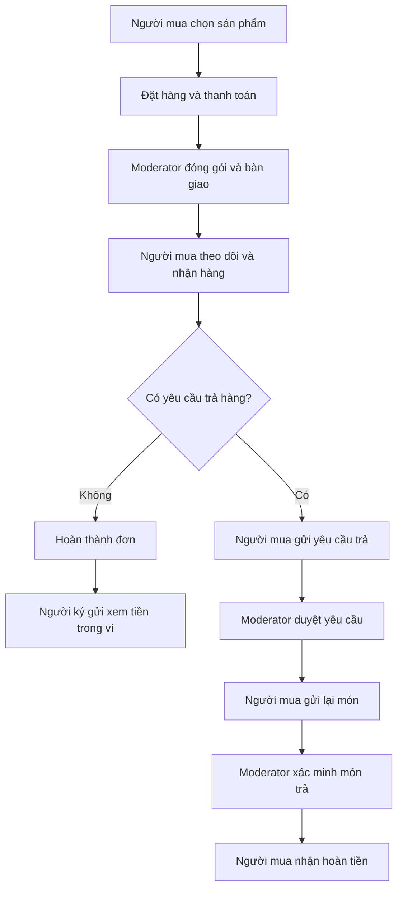

# Task BE cho demo và hiệu năng

## Phạm vi và kết quả

| Task | Kết quả trong repo | API tương ứng / API mới |
|---|---|---|
| Background job voucher | Đã có job 09:00 hằng ngày theo giờ Việt Nam, nhắc voucher UNUSED hết hạn trong 3 ngày, lưu remindedAt và khóa DB để tránh hai job xử lý cùng voucher. Bổ sung gửi thông báo sau commit, thời hạn định dạng giờ Việt Nam. | Không có API mới; job tự chạy. API liên quan hiện có: `GET /vouchers/me`, `GET /notifications`; nhận realtime qua `/user/queue/notifications`. |
| Chat không chặn từ vi phạm | Đã có mask + originalContent và API/WS; giữ content đã che cho preview/push. Chi tiết: chat-word-masking.md. | Không có API mới. Cập nhật `POST /conversations/{id}/messages`, `GET /conversations/{id}/messages` và payload WebSocket `/topic/conversations.{id}` với `originalContent`; `GET /conversations` vẫn dùng bản che cho tin cuối. |
| Tái sử dụng ảnh AI | Fingerprint SHA-256 từ mẫu, SKU từng slot, bytes ảnh và generation-version; kết quả mannequin được dùng chung giữa mọi Member. Hit không gọi AI/trừ lượt; mỗi Member có mục bộ sưu tập riêng. | Không có endpoint mới. Cập nhật `POST /tryon/images`: hit trả URL ảnh chung và ID bộ sưu tập của người gọi; response thêm `reused` (boolean), request giữ nguyên. Xem bộ sưu tập qua `GET /tryon/images`. |
| Gợi ý phối đồ bằng mô hình | Giữ luồng Gemini. Thêm mô hình Naive Bayes fit từ lịch sử mua của người đăng nhập; kết hợp luật ghép đồ. Cold start có cờ rõ ràng. Chưa đánh giá chất lượng trên người dùng thật. | **API mới: `GET /tryon/outfit-suggestions/ml?productId=...`**, MEMBER token; latitude/longitude tùy chọn, truyền cùng nhau. Response có model, personalized, historyItemsUsed, candidateItemsScored, items. Các API Gemini `/tryon/outfit-suggestions` và `/tryon/suggestions` giữ nguyên. |
| Cache GET products | Đã có Redis TTL, viewer-specific key, invalidation sau commit, fallback khi Redis lỗi; bổ sung dùng chung key cho tìm kiếm có/không dấu, giá tương đương. | Không có API mới. Cập nhật nội bộ `GET /products`; FE tiếp tục dùng query parameters cũ. |
| Tối ưu catalogue/search | Giới hạn size 50; fetch graph brand/category/warehouse/receipt để tránh query theo từng dòng; LIKE escape ký tự `%`, `_`, `!`; bổ sung script index trigram cho PostgreSQL. | Không có API mới. Cập nhật `GET /products?search=...&page=0&size=20`; size tối đa 50. |
| Kiểm thử tải Locust | Có kịch bản đọc catalogue/search/phân trang và baseline/spike/recovery, xuất HTML/CSV; chưa đo API thật. | Không có API mới; kịch bản gọi `GET /products` với danh sách, search và phân trang. |
| Kiểm thử spike JMeter | Có plan loopback giới hạn threads/thời lượng, timeout và assertion; chưa chạy JMeter. | Không có API mới; plan gọi `GET /products?page=0&size=20` trên loopback. |
| Báo cáo và luồng demo | Có tài liệu này, kịch bản đo và luồng thao tác bên dưới. Chưa có số liệu tải thực tế. | Không có API mới; chỉ bổ sung tài liệu và luồng demo. |

**Đã thêm endpoint ML riêng `GET /tryon/outfit-suggestions/ml`.** Các endpoint hiện có giữ nguyên. Chi tiết mô hình và giới hạn: `docs/ml-outfit-suggestions-api.md`.

## Kiểm chứng ngày 21/11/2026

- Chạy toàn bộ Maven test sau khi bổ sung API ML riêng: **2.048 test, 0 failures, 0 errors, 0 skipped** (144 suites).
- Test SQL thực trên H2 xác nhận page catalogue có 2 query (page + count), truy cập brand/category/receipt không thêm query theo từng dòng.
- Test SQL xác nhận mục bộ sưu tập vẫn thuộc đúng tài khoản; tài nguyên mannequin được chia sẻ. Xóa mục của A không xóa tài nguyên hay mục của B.
- Test service xác nhận reuse không gọi generator/kiểm tra/trừ quota; Member khác có row riêng, gọi lại cùng Member không tạo thêm row.
- Test fingerprint xác nhận đổi mẫu, SKU, bytes đầu vào hoặc generation-version làm mất cache hit.
- Test reminder xác nhận lưu thời điểm nhắc; helper thông báo không gửi trước commit và lỗi gửi không thoát ra thao tác chính.
- Python Locust đã kiểm tra syntax; JMeter đã parse XML. Chưa chạy hai công cụ và chưa đo p95/p99 API thật.
- Chưa chạy SQL trên PostgreSQL của người dùng, chưa deploy/commit/push.

## Triển khai ảnh AI reuse

Chạy phần thêm cột/index trong `scripts/2026-11-21_try_on_reuse.sql`
trên database đúng môi trường trước khi deploy. File không xóa dữ liệu, không thêm enum CHECK.
Index tìm kiếm nằm riêng trong `scripts/2026-11-21_product_search_indexes.sql`; pg_trgm cần quyền tạo extension. Nếu thiếu quyền, nhờ DB owner chạy script index riêng.
Các row cũ có fingerprint NULL không được coi là cache hit; không thể chứng minh đầu vào cũ giống nhau.

Thay model/checkpoint/prompt/pipeline AI: đổi `tryon.generation-version` (mặc định `v1`)
để không lấy kết quả cũ. Fingerprint gồm mẫu nam/nữ, SKU từng slot và bytes ảnh đầu vào.
Khác Member vẫn dùng chung ảnh nếu fingerprint giống nhau; memberId không nằm trong cache key.
Đổi bytes dù URL giữ nguyên vẫn làm mất cache hit. Đọc ảnh đầu vào vẫn cần storage I/O.
Sản phẩm phải còn ON_SALE và đúng slot. Chỉ chia sẻ kết quả mannequin chung;
endpoint này không nhận ảnh cơ thể cá nhân.

`try_on_shared_assets` sở hữu file; `try_on_images` là mục bộ sưu tập của từng Member.
B dùng lại ảnh của A có ID riêng nhưng cùng imageUrl. Gọi lại cùng Member trả mục hiện có.
Response `POST /tryon/images` thêm `reused=true` khi dùng lại, `false` khi tạo mới;
request và endpoint giữ nguyên.

Row tạo bằng GPU có `quota_charged=true`; row dùng lại có giá trị false và không tính quota.
Xóa mục có tài nguyên chung là xóa mềm (`deleted_at`), không xóa file hay hoàn lượt đã dùng;
GET collection/detail ẩn mục đã xóa. Legacy row chưa liên kết shared asset vẫn xóa theo cơ chế cũ.
Tài nguyên chung còn tồn tại khi không ai lưu trong bộ sưu tập; chưa thêm job dọn cache.

Script nhận lại ảnh cũ có fingerprint xác thực. Row từ trước khi có fingerprint vẫn NULL,
không tự suy đoán snapshot ảnh đầu vào hoặc phiên bản model cũ để đưa vào cache chung.
Chạy lại script này nếu đã chạy phiên bản chỉ thêm fingerprint trước đó.

Khóa theo fingerprint ngăn hai Member gọi GPU trùng đầu vào trong **một JVM**;
người đến sau đợi lượt đang tạo rồi lấy kết quả. Khóa theo Member vẫn chặn bấm lại
bằng `TRYON_IN_PROGRESS`. Không giữ transaction/DB connection lúc chờ khóa hoặc GPU.
PK fingerprint ngăn lưu trùng tài nguyên; nếu hai replica cùng publish, bên thua lấy bản thắng
và dọn file dư. Khóa JVM chưa ngăn hai replica gọi GPU đồng thời: cần khóa Redis/DB
có lease dùng chung nếu triển khai nhiều replica.

## Search: BE và FE phối hợp

BE nhận `search`, `page`, `size` cùng các filter cũ; size lớn hơn 50 được hạ xuống 50.
Giữ tương thích tìm một ký tự; không ép ngưỡng ký tự mới ở BE.
FE web/mobile nên debounce khoảng 400 ms, chỉ gửi khi từ khóa sau trim có ít nhất 2 ký tự;
khi xóa hết thì lấy danh sách mặc định. Hủy/bỏ qua response cũ khi người dùng gõ tiếp.
Đó là cấu hình FE cần áp dụng và đo UX, không phải quy tắc "mỗi 400 ms luôn gọi API".

Index trigram hỗ trợ contains search; chuỗi rất ngắn có thể vẫn cần scan.
Chạy EXPLAIN (ANALYZE, BUFFERS) trên PostgreSQL với dataset thật để kiểm chứng index;
không suy ra tốc độ PostgreSQL từ H2. Index không tự được chạy bởi tài liệu này.

## Luồng thao tác để trình bày demo

1. Member xem sản phẩm, tìm kiếm, mở chi tiết và lưu món yêu thích nếu có.
2. Chọn món phối đồ, nhận gợi ý, tạo ảnh thử; thử lại cùng bộ để thấy ảnh cũ trong bộ sưu tập.
3. Người mua đặt hàng, thanh toán; Moderator đóng gói và bàn giao.
4. Người mua theo dõi thông báo, nhận hàng, hoàn thành; người ký gửi thấy tiền vào ví sau thời hạn áp dụng.
5. Demo riêng nhánh trả hàng: gửi yêu cầu → duyệt → trả hàng → xác minh/hoàn tiền → xử lý món.
6. Chat gửi từ vi phạm: tin vẫn gửi, nội dung được che, người tham gia chọn xem bản gốc.
7. Mở ví voucher và hiển thị hạn dùng/nhắc hạn; phần highlight do mobile thực hiện.

Chỉ mở Redis, query log, kiến trúc hay báo cáo tải khi giảng viên hỏi.
Không chờ thời gian tự hoàn thành thực trong demo; dùng dữ liệu test được chuẩn bị theo trạng thái nghiệp vụ.

## Phần cần làm ngoài thay đổi BE này

- FE/mobile: highlight voucher, debounce/minimum ký tự, hủy request cũ, UI xem originalContent,
  kiểm tra render/network và sửa nơi gọi API dư thừa.
- ML: đánh giá mô hình cá nhân hóa trên tập dữ liệu tách theo thời gian; nếu muốn học cả độ hợp giữa hai món thay vì luật, cần dữ liệu cặp outfit phù hợp/không phù hợp.
- Môi trường: chạy migration, deploy/restart backend test, cài Locust/JMeter và thực hiện đo theo
  `performance/README.md`; đưa số liệu thật vào báo cáo/slide.
